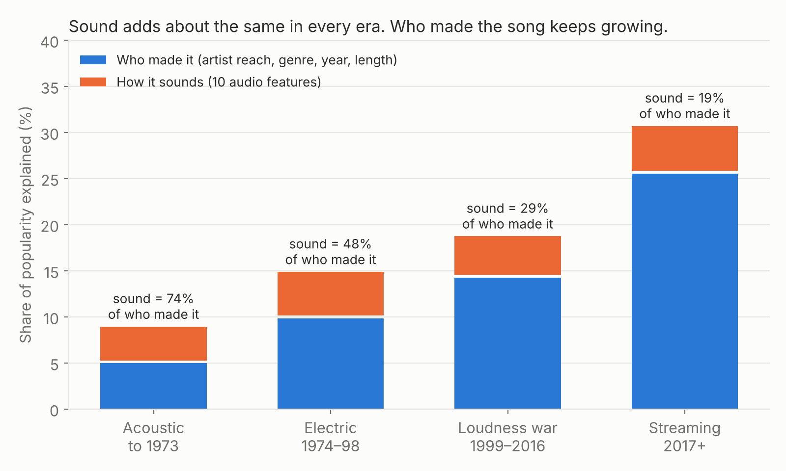
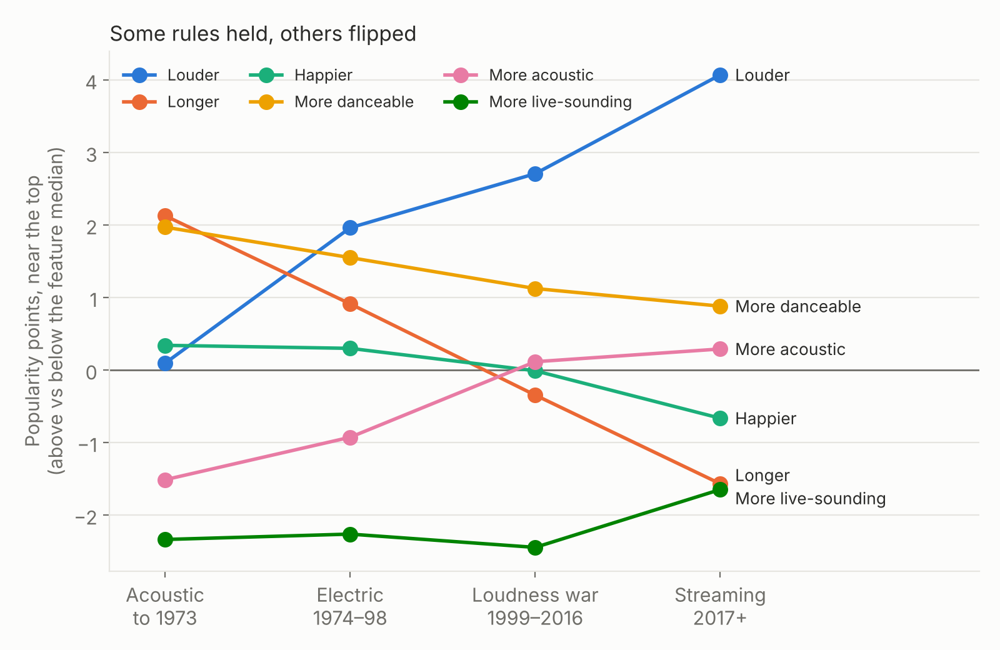

# soundstages

Does what a song sounds like matter more for big songs than small ones, once you account for who made it,
its genre and when it came out?

**Who made a song explains 8 to 10 times more of its popularity than how it sounds.** Sound still matters:
it adds 2 to 5 points of explained variation, most for typical tracks and least near the top, where artist
reach takes over. And the balance has shifted. For 1974–98 songs, sound was worth about half as much as who
made them. For streaming-era songs, it's about a fifth.



Results page: [ethannbrown.github.io/soundstages](https://ethannbrown.github.io/soundstages)

## Findings

**1. Who made it dominates.** Artist reach, genre, release year and length explain 28.7% of the variation in
popularity (linear regression, tested on artists the model never saw). Adding 10 audio features raises that
to 31.4%. At the median, XGBoost puts it at 21.0% vs 23.6%.

**2. Sound isn't just recognizing the artist.** Within one artist's own catalog, sound raises the share
explained from 3.6% to 6.5%. It separates songs from the same artist, not only artists from each other.

**3. Sound matters most for typical tracks.** Sound's extra contribution is 3 to 5 points at the 25th
percentile and the median, and about 3 points near the top (90th percentile), in every era.


**4. Sound's contribution stayed flat while who made it grew.** At the median, sound adds 3.7 to 4.9 points
in every era. What changed is everything else: background facts explain 5% of popularity for songs before
1974, 10% for 1974–98, 14% for 1999–2016 and 26% for 2017 on.

**5. Some rules held, others flipped.** Near the top, studio recordings beat live ones in every era, and
danceable tracks do better in every era (most for older songs). Loudness went from irrelevant before 1974 to
the biggest sound effect in the streaming era. Length and mood flipped: longer and happier songs did better
in older eras; shorter and moodier songs do better now.



## How we know

- **Tested on unseen artists.** Scores come from 5-fold cross-validation with each artist's tracks kept in a
  single fold, so a model never gets graded on an artist it trained on. The within-artist check instead
  splits each artist's own catalog across folds.
- **Background-only vs with-sound.** Every model runs twice, once with the background facts and once adding
  the 10 audio features. The gap is sound's contribution. Pooled across eras, the gap is 5 to 11 times its
  fold-to-fold spread.
- **Across the distribution, not just the average.** Quantile regression fits the 25th, 50th, 75th, 90th
  and 99th percentiles of heard tracks; quantile XGBoost fits the 25th, 50th and 90th. Both are scored on
  the same held-out folds.
- **Two model families.** Quantile regression gives readable effects in popularity points. XGBoost captures
  curves the regression can't, and roughly doubles sound's measured contribution. SHAP values show which
  sounds drive it.

## Limits

- **Popularity is a November 2026 snapshot.** For old songs it measures which ones survived; for new songs,
  which ones are catching on. Era comparisons mix the two.
- **Heard tracks only.** 30.6% of tracks score 0. The distribution analysis covers the 1.83M tracks with a
  score above 0. Half the zeros sit on releases where every track is 0, which usually means a duplicate copy.
- **Ten summary numbers per song.** Audio features describe sound coarsely, which caps what sound can explain.
- **The two model families disagree on one detail.** The straight-line model puts sound's peak higher up the
  distribution; XGBoost, which fits better, puts it at typical tracks. The findings above follow XGBoost.
- **Dated year 2000.** About 5,000 extra tracks carry the year 2000, likely a placeholder date. They stay in
  the data, but era boundaries were set without that year.

## Data

Every artist on Every Noise at Once with 100+ monthly listeners, and every track they released. 2,635,971
tracks from 19,206 artists. Albums, tracks, popularity and audio features from the ReccoBeats API.

| **Genre** | **Collected** | **MDN. Listeners** | **Tracks** |
| :--- | :---: | :---: | :---: |
| Electronic | 2260 | 77,805.5 | 269,190 |
| Latin | 2179 | 313,512 | 366,410 |
| Hip-Hop | 2057 | 112,018 | 292,756 |
| Pop | 1564 | 402,701.5 | 151,291 |
| Rock | 1226 | 268,095 | 245,126 |
| Jazz | 1124 | 24,686 | 260,405 |
| Folk | 1088 | 47,128 | 163,378 |
| Caribbean | 919 | 40,990 | 120,597 |
| Metal | 860 | 31,450 | 92,891 |
| Blues | 835 | 13,152 | 134,668 |
| Indie | 800 | 300,843 | 67,928 |
| African | 702 | 120,415 | 45,667 |
| Country | 690 | 185,207.5 | 113,166 |
| Punk | 632 | 22,427.5 | 68,995 |
| Ambient | 598 | 4,380 | 71,291 |
| Soul | 578 | 30,550 | 59,295 |
| R&B | 571 | 300,414 | 41,595 |
| Funk | 518 | 48,513 | 46,437 |
| Gospel | 409 | 12,556 | 24,885 |

Sonic eras were set from yearly medians of the audio features alone, never from popularity: Acoustic (to
1973), Electric (1974–98), Loudness war (1999–2016), Streaming (2017 on).

## Pipeline

| Stage | Script | Output |
|---|---|---|
| Artists from Every Noise at Once | src/collect/artists.py | nominees.parquet |
| Monthly listeners | src/collect/listeners.py | listeners.parquet |
| Primary genre | src/collect/resolve.py | resolved.parquet |
| Dataset merging | src/prepare/merge.py | artists.parquet |
| Spotify ID to ReccoBeats ID | src/collect/ids.py | ids.parquet |
| Album collection | src/collect/albums.py | albums.parquet |
| Album cleaning | src/prepare/clean_albums.py | albums_clean.parquet |
| Track collection | src/collect/tracks.py | tracks.parquet |
| Track cleaning | src/prepare/clean_tracks.py | tracks_clean.parquet |
| Audio features | src/collect/features.py | features.parquet |
| Join, feature checks, flags | src/prepare/build.py | dataset.parquet |
| Model table and folds | src/model/prep.py | model_table.parquet |
| Baselines and linear models | src/model/baselines.py, linear.py | predictions/ |
| Scores and audio gain | src/model/evaluate.py | scores.csv, audio_gain.csv |
| Quantile regression | src/model/quantile.py, quantile_era.py | quantile_*.csv |
| Quantile XGBoost and SHAP | src/model/boost.py | boost_scores.csv, boost_shap.csv |
| Figures | src/report/figures.py | docs/figures/ |

src/collect/ scripts collect from Every Noise at Once, Spotify artist pages, and ReccoBeats. They ran once
and aren't rerun. src/prepare/ scripts rebuild from the collected files in minutes.
Paths are in config.py. Data isn't committed.

## Reproducing

With the collected files in data/inputs/, from the project root:

```
uv sync
uv run python src/prepare/merge.py
uv run python src/prepare/clean_albums.py
uv run python src/prepare/clean_tracks.py
uv run python src/prepare/build.py
uv run python src/model/prep.py
uv run python src/model/baselines.py
uv run python src/model/linear.py
uv run python src/model/evaluate.py
uv run python src/model/quantile.py
uv run python src/model/quantile_era.py
uv run python src/model/boost.py
uv run python src/report/figures.py
```

boost.py takes about an hour; everything else runs in minutes.

Saving and checking outputs against a reference copy:

```
uv run python reference.py save
uv run python reference.py check
```

Tests: `uv run pytest`. Lint: `uv run ruff check .`
