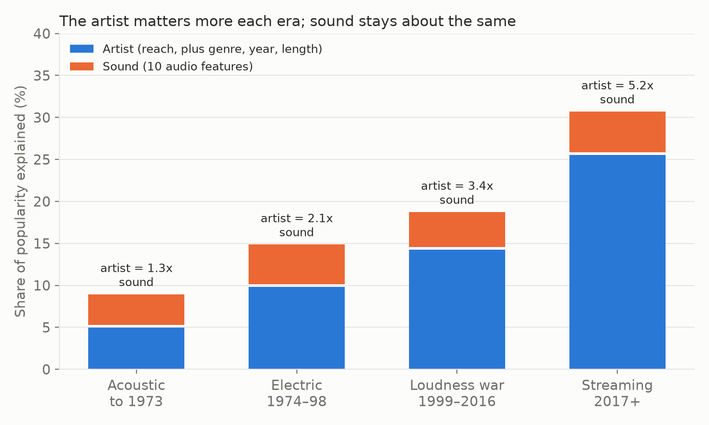
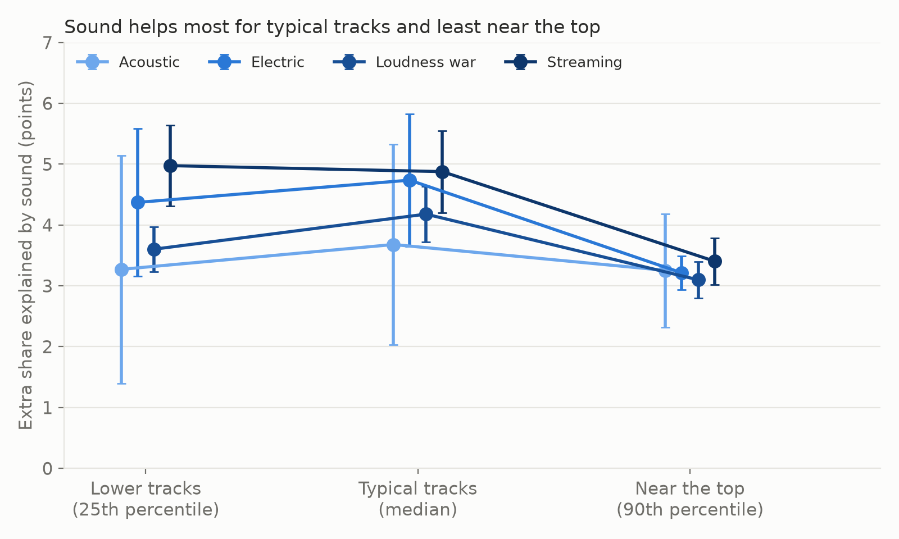

# soundstages
     <br>

Is sound what makes a song big?

**Not really.** Sound helps "typical" (median pop.) songs the most and the biggest (most popular) songs the least, where the artist's reach
takes over. The artist (their reach, plus genre, release year and track length) predicts 8 to 10 times more of
a song's popularity than its sound does, and that gap has widened. The artist mattered about twice as much as
sound for 1974–98 songs and about five times as much in the streaming era.



*Each bar is one era, measured at the median song. Blue is how much of popularity the artist predicts on their
own; orange is what the 10 audio features add on top. The label over each bar is how many times larger the
artist's share is than sound's. Scores come from quantile XGBoost, tested on artists the model never trained
on.*

Results page: [ethannbrown.github.io/soundstages](https://ethannbrown.github.io/soundstages)

## Findings

**1. Artist identity is a dominating factor:** Artist reach, genre, release year and length explain 28.7% of the variation in
popularity, tested on artists the model never saw. Adding the 10 audio features only gets the linear
regression to 31.4%. XGBoost tells the same story at the median, 21.0% without sound and 23.6% with it.

**2. Sound is more than an artist or genre indicator:** If audio features only helped by recognizing the artist,
they'd add nothing inside one artist's catalog. They do add something: the share explained goes from 3.6% to
6.5%, so sound separates songs from the same artist, not just artists from each other.

**3. Sound matters most for typical tracks** Sound adds 3 to 5 points at the 25th percentile and the median
but only about 3 near the top (90th percentile), and the pattern repeats across eras. Up there, the artist
does most of the work.



*Each line is one era. Its height is how much adding sound improves the prediction, in percentage points, at
three spots in the popularity distribution: the 25th percentile, the median and the 90th percentile. Error
bars show the spread across the 5 cross-validation folds.*

**4. Sound stayed flat while the artist's share grew:** At the median, sound adds 3.7 to 4.9 points in every
era. The artist's share is what moved, from 5% of popularity for songs before 1974 to 10% for 1974–98, 14% for
1999–2016 and 26% for 2017 on. I believe streaming leans on artist reach, with playlists and recommendations
surfacing artists people already follow, so the artist counts for more now. The models don't test that
directly.

**5. Some rules are timeless while others flipped:** Near the top, studio recordings beat live ones in every era, and
danceable tracks do better throughout, most of all for older songs. Loudness went from irrelevant before 1974
to the biggest sound effect in the streaming era. Length and mood reversed: longer, happier songs did better
in older eras, and shorter, moodier songs do better now.


*Each line is one audio feature, measured near the top (90th percentile). A point is the average popularity
difference, in points, between tracks above that feature's median and tracks below it, taken from XGBoost's
SHAP values. Above zero means more of that feature goes with higher predicted popularity.*

## Methodology

- **Unseen artists:** Scores come from 5-fold cross-validation with each artist's tracks kept in one fold, so
  no model is graded on an artist it trained on. The within-artist check splits each artist's own catalog
  across folds instead.
- **Artist only vs with sound:** Every model runs twice, once on the artist alone and once with the 10 audio
  features added, and the gap between them is sound's contribution. Pooled across eras, that gap is 5 to 11
  times its fold-to-fold spread, well clear of noise.
- **Evaluating the whole distribution:** Quantile regression fits the 25th, 50th, 75th, 90th and
  99th percentiles of heard tracks; quantile XGBoost fits the 25th, 50th and 90th. Both are scored on the same
  held-out folds.
- **Two model families:** Quantile regression gives effects in popularity points that are easy to read.
  XGBoost picks up curves the regression can't and roughly doubles sound's measured contribution, and its SHAP
  values show which sounds drive it.

## Limits

- **Popularity is a November 2026 snapshot.** For old songs it measures which ones survived; for new songs it measures
  which ones are catching on. Era comparisons mix the two, and survivorship is the obvious alternative to the
  streaming explanation in finding 4.
- **Heard tracks only:** 30.6% of tracks score 0, so the distribution analysis covers the 1.83M tracks above
  0. Half the zeros sit on releases where every track is 0, which usually means a duplicate copy.
- **Ten summary numbers per song:** Audio features are the most robust/comprehensive descriptors of a song's sound, which caps how much sound can explain.
- **Year 2000:** About 5,000 extra tracks are dated 2000, likely a placeholder. I kept them in the data but
  set the era boundaries without that year.

## Data

Every artist on Every Noise at Once with 100+ monthly listeners, and every track they released. 2,635,971
tracks from 19,206 artists. Albums, tracks, popularity and audio features from the ReccoBeats API.

| **Genre** | **Collected** | **MDN. Listeners** | **Tracks** |
| :--- | :---: | :---: | :---: |
| Electronic | 2260 | 77,805.5 | 269,190 |
| Latin | 2179 | 313,512 | 366,410 |
| Hip-Hop | 2057 | 112,018 | 292,756 |
| Pop | 1564 | 402,701.5 | 151,291 |
| Rock | 1226 | 268,095 | 245,126 |
| Jazz | 1124 | 24,686 | 260,405 |
| Folk | 1088 | 47,128 | 163,378 |
| Caribbean | 919 | 40,990 | 120,597 |
| Metal | 860 | 31,450 | 92,891 |
| Blues | 835 | 13,152 | 134,668 |
| Indie | 800 | 300,843 | 67,928 |
| African | 702 | 120,415 | 45,667 |
| Country | 690 | 185,207.5 | 113,166 |
| Punk | 632 | 22,427.5 | 68,995 |
| Ambient | 598 | 4,380 | 71,291 |
| Soul | 578 | 30,550 | 59,295 |
| R&B | 571 | 300,414 | 41,595 |
| Funk | 518 | 48,513 | 46,437 |
| Gospel | 409 | 12,556 | 24,885 |

I set the sonic eras from yearly medians of the audio features alone, never from popularity: Acoustic (to
1973), Electric (1974–98), Loudness war (1999–2016), Streaming (2017 on).

## Pipeline

| Stage | Script | Output |
|---|---|---|
| Artists from Every Noise at Once | src/collect/artists.py | nominees.parquet |
| Monthly listeners | src/collect/listeners.py | listeners.parquet |
| Primary genre | src/collect/resolve.py | resolved.parquet |
| Dataset merging | src/prepare/merge.py | artists.parquet |
| Spotify ID to ReccoBeats ID | src/collect/ids.py | ids.parquet |
| Album collection | src/collect/albums.py | albums.parquet |
| Album cleaning | src/prepare/clean_albums.py | albums_clean.parquet |
| Track collection | src/collect/tracks.py | tracks.parquet |
| Track cleaning | src/prepare/clean_tracks.py | tracks_clean.parquet |
| Audio features | src/collect/features.py | features.parquet |
| Join, feature checks, flags | src/prepare/build.py | dataset.parquet |
| Model table and folds | src/model/prep.py | model_table.parquet |
| Baselines and linear models | src/model/baselines.py, linear.py | predictions/ |
| Scores and audio gain | src/model/evaluate.py | scores.csv, audio_gain.csv |
| Quantile regression | src/model/quantile.py, quantile_era.py | quantile_*.csv |
| Quantile XGBoost and SHAP | src/model/boost.py | boost_scores.csv, boost_shap.csv |
| Figures | src/report/figures.py | docs/figures/ |

src/collect/ scripts collect from Every Noise at Once, Spotify artist pages, and ReccoBeats. They ran once
and aren't rerun. src/prepare/ scripts rebuild from the collected files in minutes.
Paths are in config.py. Data isn't committed.

## Reproducing

With the collected files in data/inputs/, from the project root:

```
uv sync
uv run python src/prepare/merge.py
uv run python src/prepare/clean_albums.py
uv run python src/prepare/clean_tracks.py
uv run python src/prepare/build.py
uv run python src/model/prep.py
uv run python src/model/baselines.py
uv run python src/model/linear.py
uv run python src/model/evaluate.py
uv run python src/model/quantile.py --all
uv run python src/model/quantile_era.py --all
uv run python src/model/boost.py --all
uv run python src/report/figures.py
```

Without --all, quantile.py, quantile_era.py and boost.py time one fit and stop. boost.py takes about an
hour; everything else runs in minutes.

Saving and checking outputs against a reference copy:

```
uv run python reference.py save
uv run python reference.py check
```

Tests need the collection extra: `uv sync --extra collection`, then `uv run pytest`. Lint: `uv run ruff check .`
